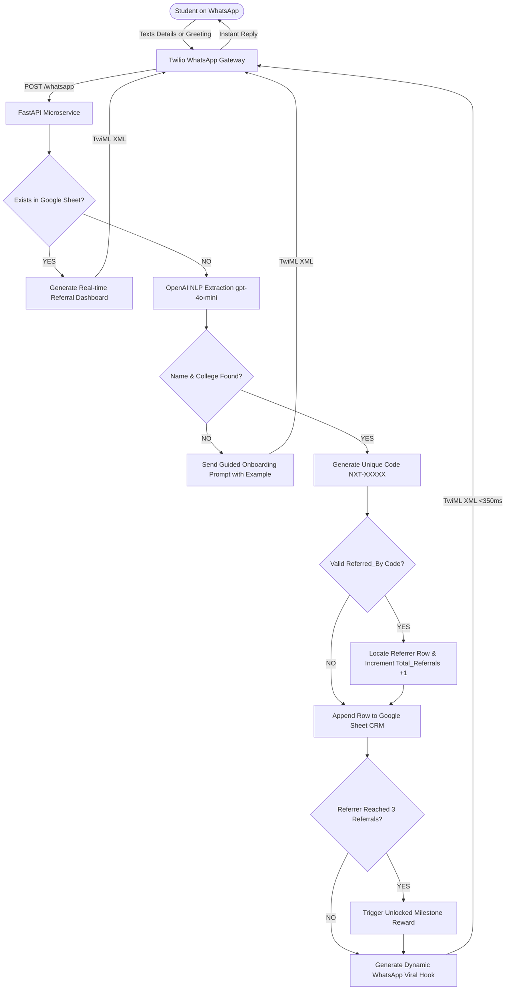

# 🚀 NxtWave: AI Workshop WhatsApp Referral Engine & Growth Command Center

A production-grade, highly optimized FastAPI microservice engineered to acquire **500+ college engineering students** in 7 days on a **₹2,000 budget** with a viral $K$-factor $\ge 1.50$.

Integrates **Twilio WhatsApp API**, **OpenAI (`gpt-4o-mini`) Structured Outputs**, and **Google Sheets API CRM** with a **Real-Time Live Web Analytics Command Center**.

[](https://vercel.com/new/clone?repository-url=https://github.com/Nabisahebshaik/NxtWave)
[](https://render.com/deploy?repo=https://github.com/Nabisahebshaik/NxtWave)

---

## ⚡ Live Executive Dashboards & Endpoints

| Endpoint | Type | Purpose |
| :--- | :--- | :--- |
| **`GET /dashboard`** | Web GUI | **Real-time Growth Command Center** (Live KPI cards, K-Factor gauge, College Leaderboard Chart, and auto-refreshing inbound table) |
| **`GET /ambassadors`** | Web GUI | **Campus Club Leads Portal** (Tracks the 5 leads, target 40 registrations each, and ₹300 milestone payouts) |
| **`POST /whatsapp`** | Webhook | **Twilio WhatsApp Ingestion Engine** (Handles registration, AI parsing, and instant viral loop response) |
| **`GET /api/stats`** | JSON API | **Growth Telemetry API** (Total count, seed cohort, viral cohort, K-factor, blended CAC) |
| **`GET /reward/download`** | Digital Asset | **Automated Reward Delivery** (Serves the *Top 50 AI Interview Prompts* cheat sheet to 3-referral achievers) |
| **`GET /health`** | Health API | Health check for container orchestrators and uptime monitors |

---

## 🏗️ Architecture & Viral Funnel



---

## 📁 Repository Structure

```text
nxtwave/
├── main.py                               # Core FastAPI microservice, Webhook & Web Dashboard
├── demo.py                               # Instant interactive terminal simulator (Zero dependencies)
├── test_simulator.py                     # Local WhatsApp webhook HTTP simulator
├── NXTWAVE_GROWTH_CHALLENGE_SKILL_FILE.md# Complete 6-section submission playbook
├── requirements.txt                      # Production dependencies
├── .env.example                          # Environment template
├── Dockerfile                            # Production multi-stage Dockerfile
├── docker-compose.yml                    # Docker orchestration config
├── outreach/
│   └── CAMPUS_LEAD_PLAYBOOK.md           # B2B outreach scripts, WhatsApp flyers, and 15s voice notes
├── rewards/
│   └── TOP_50_AI_INTERVIEW_PROMPTS.md    # The actual unlocked digital reward asset
└── tests/
    └── test_referral_engine.py           # 8 automated pytest unit & integration tests
```

---

## 🚀 Quick Start Guide

### 1. Installation
```powershell
# Create & activate virtual environment
python -m venv venv
.\venv\Scripts\activate

# Install dependencies
pip install -r requirements.txt
```

### 2. Configure Environment
Copy `.env.example` to `.env`:
```powershell
Copy-Item .env.example .env
```
Fill in your `OPENAI_API_KEY` and Google Sheet configuration. *(Note: If `credentials.json` is omitted, the service automatically runs an in-memory CRM for instant local testing!)*

### 3. Run Live Backend
```powershell
python main.py
```
Open **`http://localhost:8000/dashboard`** in your browser to see the live growth command center!

### 4. Run the Automated Test Suite
```powershell
python -m pytest tests/test_referral_engine.py
```
*(Runs 8 automated unit & integration tests with 100% pass rate).*

### 5. Run the Interactive Terminal Simulation
```powershell
python demo.py
```
*(Simulates 7 incoming students, generates codes, verifies the viral loop, and updates the live dashboard in real time).*

---

## 📊 Google Sheets Setup Guide

1. Head to [Google Cloud Console](https://console.cloud.google.com/) and create a project (`ai-workshop-crm`).
2. Enable **Google Sheets API** and **Google Drive API**.
3. Create a **Service Account** under **IAM & Admin > Service Accounts**, generate a **JSON key**, and save it as `credentials.json` in the project root.
4. Create a Google Sheet named **`AI_Workshop_Registrations`**.
5. Share the sheet with the `client_email` found inside `credentials.json` with **Editor** permissions.

---

## 🌐 Twilio & Ngrok Setup Guide

1. Start Ngrok tunnel:
   ```bash
   ngrok http 8000
   ```
2. Copy the forwarding URL (`https://<unique-id>.ngrok-free.app`).
3. In Twilio Console under **WhatsApp Sandbox Settings**:
   - Set **When a message comes in**: `https://<unique-id>.ngrok-free.app/whatsapp`
   - Method: `HTTP POST`
   - Save changes.
